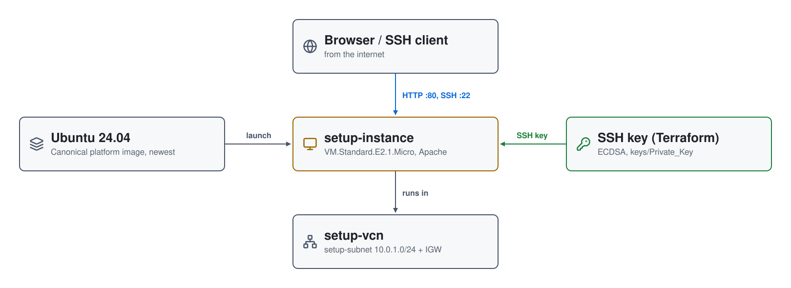

# OCI + Terraform Setup

The companion project to the OCI + Terraform setup video. It shows how to
give the OCI CLI and Terraform an API signing key, then proves the setup
works by building the smallest useful thing: a VCN with one public subnet and
an Ubuntu instance running Apache.

[](https://www.youtube.com/watch?v=yu190JktZr0)

| Piece | Where | Role |
|---|---|---|
| **setup-instance** | `setup-subnet` (10.0.1.0/24) | `VM.Standard.E2.1.Micro` (Always Free eligible), Canonical's newest Ubuntu 24.04 platform image; cloud-init installs Apache; public IP |
| **setup-vcn** | us-ashburn-1 | 10.0.0.0/16, with `setup-igw` and a route table for the subnet |
| **setup-security-list** | `setup-subnet` | 22 and 80 from anywhere |
| **SSH key** | `keys/Private_Key` | an ECDSA key pair Terraform generates on each fresh deploy; `keys/` is gitignored |

## Architecture

<picture>
  <source media="(prefers-color-scheme: dark)" srcset="architecture-dark.svg">
  
</picture>

Regenerate with `python3 make_diagram.py`.

Everything is in `main.tf`. `scripts/userdata.sh` waits for IPv4 internet,
points apt at `us.archive.ubuntu.com`, installs and starts Apache, and opens
port 80 in the image's iptables rules, which block it by default.

## Give Terraform access to OCI

You need an OCI account; the [Free Tier](https://www.oracle.com/cloud/free/)
(Always Free) is enough for this project.

1. **API signing key**: in the OCI Console, open the **Profile** menu
   (top right) > **My profile** > **Tokens and keys** > **Add API key** >
   **Generate API key pair**. Download the private key as
   `~/.oci/oci_api_key.pem` and choose **Add**.
2. **CLI config**: OCI then shows a configuration file preview. Paste it
   into `~/.oci/config` and point `key_file` at the key:

   ```
   [DEFAULT]
   user=ocid1.user.oc1..aaaa...
   fingerprint=xx:xx:xx:xx:xx:xx:xx:xx:xx:xx:xx:xx:xx:xx:xx:xx
   tenancy=ocid1.tenancy.oc1..aaaa...
   region=us-ashburn-1
   key_file=~/.oci/oci_api_key.pem
   ```

   ```bash
   chmod 600 ~/.oci/config ~/.oci/oci_api_key.pem
   oci os ns get     # prints your Object Storage namespace if it works
   ```

3. **Compartment**: use the root compartment (its OCID is your tenancy
   OCID), or create one under **Identity & Security > Compartments** and copy
   its OCID. Then:

   ```bash
   export OCI_COMPARTMENT_ID="ocid1.compartment.oc1..aaaa..."
   ```

   If it's unset, `apply.sh` and `destroy.sh` use the tenancy OCID from
   `~/.oci/config`.

## Prerequisites

* [Install OCI CLI](https://docs.oracle.com/en-us/iaas/Content/API/SDKDocs/cliinstall.htm)
* [Install Terraform](https://developer.hashicorp.com/terraform/install)
* [Install Packer](https://developer.hashicorp.com/packer/install)

`check_env.sh` checks that `oci`, `packer` and `terraform` are on your `PATH`
(Packer isn't used here, but the later projects need it) and that the OCI
CLI can connect.

## Deploy

```bash
git clone https://github.com/mamonaco1973/oci-setup.git
cd oci-setup
./apply.sh
```

The instance is created in `us-ashburn-1`, in the first availability
domain. `apply.sh` ends by running `validate.sh`, which waits up to 12
minutes for Apache to answer:

```
================================================================================
  OCI Setup - Instance Validated
================================================================================
  URL : http://203.0.113.10
================================================================================
```

## Try it

1. Open the URL: Apache's test page.

   

2. SSH in with the generated key:

   ```bash
   ssh -i ./keys/Private_Key ubuntu@<instance_public_ip>
   ```

## Teardown

```bash
./destroy.sh
```

## Notes

- **Lab only.** SSH and HTTP are open to the internet. Restrict
  `setup-security-list` for anything more.
